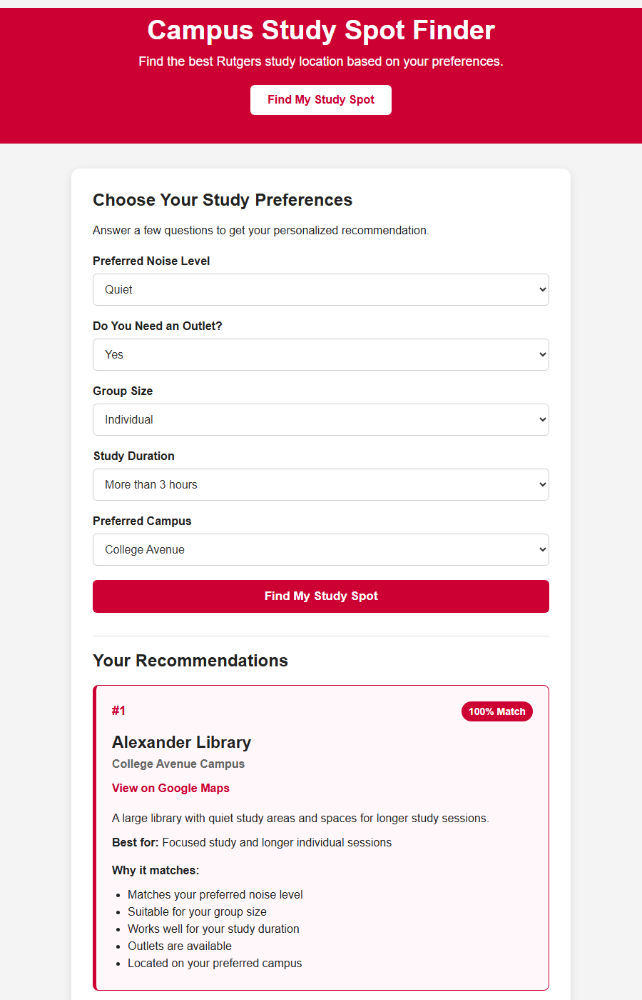

# Campus Study Spot Finder

A small, dependency-free web app that recommends Rutgers–New Brunswick study
locations based on how you like to study: noise level, group size, session
length, whether you need an outlet, and which campus you prefer.

**Live site:** https://k086-cloud.github.io/campus-study-spot-finder/



## Features

- Five-question preference form: noise level, outlet, group size, study duration, campus
- Scores every location and shows the top three with a match percentage
- Explains why each spot matched your answers
- Warns when no spot on your preferred campus is a perfect match and shows the closest alternatives
- Google Maps link for every spot
- Responsive layout that works on phones
- Plain HTML, CSS and JavaScript: no build step, no frameworks, no dependencies

## How the scoring works

Each entry in `locations.json` is compared with your answers:

| Criterion                     | Points | Counted when                                  |
| ----------------------------- | ------ | --------------------------------------------- |
| Noise level matches           | 3      | always                                        |
| Supports your group size      | 2      | always                                        |
| Supports your study duration  | 2      | always                                        |
| Has outlets                   | 1      | only if you said you need an outlet           |
| On your preferred campus      | 2      | only if you picked a campus                   |

The match percentage is the score divided by the maximum possible score for
your answers, rounded to a whole number. Locations are sorted by score and the
top three are shown.

## Running locally

The page loads `locations.json` with `fetch()`, which browsers block on
`file://` URLs, so double-clicking `index.html` will not work. Serve the folder
over HTTP instead:

```bash
npx serve .
```

Then open the URL it prints (usually http://localhost:3000). Any static server
works, for example the VS Code **Live Server** extension or
`python -m http.server`.

## Project structure

| File             | Purpose                                                  |
| ---------------- | -------------------------------------------------------- |
| `index.html`     | Page markup and the preference form                      |
| `style.css`      | Styling, including the mobile layout                     |
| `script.js`      | Loads the data, scores the locations, renders the results |
| `locations.json` | The study-spot data                                      |

## Adding or editing a location

Add an object to `locations.json`:

```json
{
    "name": "Alexander Library",
    "campus": "College Avenue",
    "noiseLevel": "quiet",
    "outlets": true,
    "groupSizes": ["individual", "small"],
    "durations": ["medium", "long"],
    "bestFor": "Focused study and longer individual sessions",
    "description": "A large library with quiet study areas and spaces for longer study sessions.",
    "dataSource": "Initial project estimate",
    "verified": false,
    "lastVerified": null
}
```

| Field                       | Allowed values                                                      |
| --------------------------- | ------------------------------------------------------------------- |
| `campus`                    | `College Avenue`, `Busch`, `Livingston`, `Cook/Douglass`            |
| `noiseLevel`                | `quiet`, `moderate`, `social`                                       |
| `groupSizes`                | any of `individual`, `small`, `large`                               |
| `durations`                 | any of `short`, `medium`, `long`                                    |
| `verified` / `lastVerified` | `true` and an ISO date once someone has checked the spot in person |

## Data disclaimer

All current entries are initial estimates and have not been verified on site.
Conditions change with the time of day and the semester, so treat the results
as a starting point rather than real-time availability.

## Roadmap

- More locations, with opening hours, amenities and an "open now" filter
- Partial credit for neighbouring noise levels and a "what didn't match" list
- Campus-only filter and a "show all results" option
- Shareable result links via URL parameters
- Embedded map

## License

[MIT](LICENSE)
